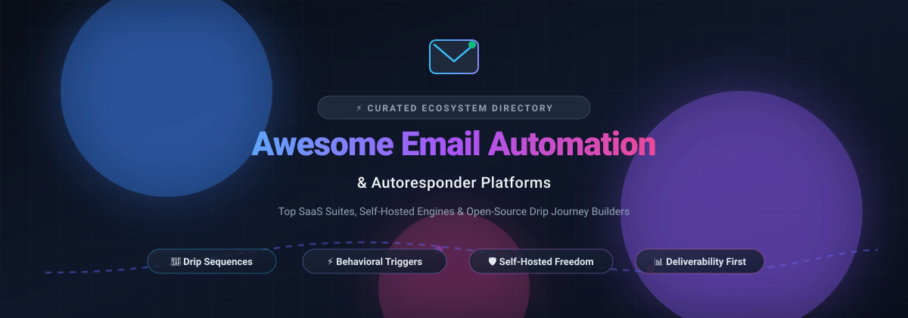

# ✉️ Awesome-Email-Automation-Autoresponder

  

  
  
  
  
  
  

---

## 🚀 Top Email Automation & Autoresponder Ecosystem

> **Curated directory of SaaS marketing automation platforms, self-hosted newsletter senders, and open-source autoresponder engines.**  
> *Engineered for lifecycle marketers, growth engineers, and developers seeking high deliverability, automated drip funnels, and data sovereignty.*  
> **Last updated: March 2026**

This repository tracks notable **SaaS platforms** and **open-source projects** for **Email Automation & Autoresponders**. These tools help organizations send targeted email sequences triggered by subscriber actions—covering everything from simple welcome series to complex behavioral branching and multi-channel marketing automation.

---

## 📑 Table of Contents
- [📊 Sector Overview & Market Dynamics](#-sector-overview--market-dynamics)
- [☁️ SaaS / Hosted Platforms](#️-saas--hosted-platforms)
- [🔓 Open-Source GitHub Projects](#-open-source-github-projects)
- [🛠️ How to Contribute](#️-how-to-contribute)
- [⭐ Star History](#-star-history)
- [💖 Support](#-support)
- [⚠️ Disclaimer](#️-disclaimer)

---

## 📊 Sector Overview & Market Dynamics

The global email marketing software market is estimated at **$1.7B – $1.8B** (expanding to **$8B – $11B+** when including the broader marketing automation ecosystem), compounding at an annual growth rate of ~9%–14%. The sector exhibits a **barbell market dynamic**: it is consolidated at the top among a handful of heavyweight platforms (e.g., Mailchimp, Klaviyo, HubSpot) capturing massive market share, yet simultaneously fragmented across mid-market and edge niches driven by vertical specialization (creator economy, e-commerce) and the emergence of AI-native orchestration tools.

---

## ☁️ SaaS / Hosted Platforms

| Product | Company Size (Valuation / Revenue) | Description | Starting Pricing (Specific Tier) | Free Tier / Trial Limits |
|:---|:---|:---|:---|:---|
| **[Mailchimp](https://mailchimp.com/)** | **$12B Valuation** (Acquired by Intuit) / ~$1.3B ARR | Industry-standard email marketing platform with visual journey builder, segmentation, and extensive third-party app ecosystem. | **$13/month** (*Essentials*, 500 contacts, up to 5,000 monthly sends; Standard from $20/month) | **Free tier**: up to 250 contacts, 500 email sends/month (max 250 sends/day) |
| **[Klaviyo](https://www.klaviyo.com/)** | **~$6B Market Cap** (NYSE: KVYO) / ~$1.4B ARR | E-commerce-focused lifecycle automation platform with deep Shopify/e-commerce integrations and predictive analytics. | **$20/month** (500 active profiles, up to 5,000 monthly sends) | **Free tier**: up to 250 active profiles, 500 email sends/month |
| **[ActiveCampaign](https://www.activecampaign.com/)** | **$3B Valuation** (Series C) / ~$250M ARR | Automation-first platform specializing in complex multi-branch conditional triggers, CRM, and dynamic lifecycle messaging. | **$19/month** (*Starter* plan, 1,000 contacts; or $15/month billed annually) | **14-day free trial**: capped at 100 contacts, 100 total sends, 1 user seat |
| **[Brevo](https://www.brevo.com/)** | **$1B+ Valuation** (Unicorn) / ~$215M ARR | European multi-channel suite for transactional and marketing email, SMS, and WhatsApp with volume-based pricing. | **$9/month** (*Starter* plan, 5,000 emails/month; Standard automation from $18/month) | **Free tier**: 300 emails/day (~9,000/month), storage for up to 100,000 contacts |
| **[Kit](https://kit.com/)** *(formerly ConvertKit)* | **~$200M Valuation** / ~$50M ARR | Creator-centric email platform built for newsletters, digital commerce, audience tagging, and broadcast monetization. | **$39/month** (*Creator* plan, 1,000 subscribers; or $33/month billed annually) | **Free tier**: up to 10,000 subscribers with unlimited broadcasts (automations locked) |
| **[GetResponse](https://www.getresponse.com/)** | **~$120M Valuation** / ~$100M ARR | Comprehensive marketing platform with autoresponders, visual automation flows, landing pages, and webinars. | **$19/month** (*Starter* plan, 1,000 contacts; or $15.58/month billed annually) | **14-day full free trial** (auto-converts to Free plan: up to 500 contacts, 2,500 sends/month) |
| **[Moosend](https://moosend.com/)** | **Acquired by Constant Contact** / ~$4M+ ARR | Lightweight email automation and autoresponder platform offering visual workflows and predictive product recommendations. | **$9/month** (*Pro* plan, 500 subscribers, unlimited email sends) | **30-day free trial**: up to 1,000 contacts with unlimited email sends |

---

## 🔓 Open-Source GitHub Projects

Curated list of notable open-source self-hosted autoresponders, newsletter senders, and marketing automation systems, **sorted in descending order by GitHub stars**:

| Repository | Stars | Language / Stack | License | Description |
|:---|:---:|:---:|:---:|:---|
| **[Novu](https://github.com/novuhq/novu)** |  | TypeScript | MIT | **Open-source communication infrastructure & workflow engine.** Multi-channel orchestration across email, SMS, push, in-app notifications, and chat with a visual workflow editor and digest engines. |
| **[Listmonk](https://github.com/knadh/listmonk)** |  | Go / Vue | AGPL-3.0 | **High-performance newsletter & mailing list manager.** Packed into a single lightweight binary with PostgreSQL backend. Sends millions of emails with ultra-low latency; supports API triggers, templating, and bulk campaigns. |
| **[BillionMail](https://github.com/Billionmail/BillionMail)** |  | Go / Docker | Open Source | **All-in-one mail server, newsletter & email marketing platform.** Developer-friendly, fully self-hosted ecosystem built to eliminate recurring SaaS subscription fees. |
| **[Mautic](https://github.com/mautic/mautic)** |  | PHP / Symfony | GPL-3.0 | **Full-featured enterprise marketing automation platform.** Visual campaign builder with conditional branching, lead scoring, web tracking, dynamic content, and CRM sync. The open-source alternative to HubSpot and Marketo. |
| **[Mailtrain](https://github.com/Mailtrain-org/mailtrain)** |  | Node.js / MySQL | GPL-3.0 | **Self-hosted newsletter & triggered campaign manager.** Features subscriber management, custom fields, list segmentation, RSS-to-email, and multi-step autoresponders. |
| **[Dittofeed](https://github.com/dittofeed/dittofeed)** |  | TypeScript | MIT | **Open-source customer engagement platform.** Behavioral user journey automation across email, mobile push, SMS, and WhatsApp. Designed as a self-hosted alternative to Customer.io, Braze, and Iterable. |
| **[Notifuse](https://github.com/Notifuse/notifuse)** |  | Go / React | AGPL-3.0 | **Modern email marketing and visual automation platform.** Includes a drag-and-drop MJML email builder, visual node-based sequence/flow builder with delays and conditional paths, and native multi-provider routing. |
| **[Keila](https://github.com/pentacent/keila)** |  | Elixir / Phoenix | AGPL-3.0 | **GDPR-compliant, modern newsletter management tool.** Clean UX, reliable deliverability via SMTP/SES/Mailgun, subscriber segmentation, and privacy-respecting analytics. |
| **[SendPortal](https://github.com/mettle/sendportal)** |  | PHP / Laravel | MIT | **Self-hosted email marketing and newsletter platform.** Multi-workspace support for agency client management, integration with AWS SES, Postmark, and Mailgun, plus unlimited subscribers. |
| **[Mailcheap](https://github.com/marclou/mailcheap)** |  | Next.js / MongoDB | Open Source | **Open-source pay-per-send newsletter engine.** Built as an indie-friendly alternative to Beehiiv and Substack to avoid per-subscriber pricing by leveraging Amazon SES. |
| **[phpList](https://github.com/phpList/phplist3)** |  | PHP | AGPL-3.0 | **Battle-tested open-source newsletter & autoresponder system.** Actively maintained since 2000, handling massive lists, automated bounce processing, scheduled drip autoresponders, and subscriber self-service. |

---

## 🛠️ How to Contribute

Contributions are welcome and greatly appreciated! 💡

1. 🍴 **Fork the repository**
2. 🌿 **Create a new branch** (`git checkout -b feature/add-new-platform`)
3. ✍️ **Add or edit entries in `README.md`** (follow existing tabular formatting)
4. 🔍 **Ensure verified details** (include verified starting prices, precise free tier/trial limits, and official stargazer links)
5. 🚀 **Submit a Pull Request** with a concise description of your additions

---

## ⭐ Star History

---

## 💖 Support

Thank you for visiting and supporting this ecosystem directory! If you find this curated list valuable:

- ⭐ **Star this repository** to help others discover it!
- 🍴 **Fork and share** it with your fellow growth marketers and developers!
- ☕ **Buy me a coffee**: If you'd like to support ongoing maintenance and research, consider sponsoring via the [GitHub Sponsor Dashboard](https://github.com/sponsors/ishandutta2007).

---

## ⚠️ Disclaimer

- This is an **independent, community-curated** list — not exhaustive and not an official corporate endorsement.
- Email automation systems handle sensitive subscriber PII and sending domain reputations. Always enforce double opt-in, clear unsubscribe mechanisms, and strict compliance with CAN-SPAM, GDPR, CASL, and anti-spam protocols.
- **Self-hosted sending requires proper domain authentication (SPF, DKIM, DMARC, BIMI) and proactive IP warm-up** to avoid deliverability penalties.

---

  <b>Made with ❤️ for growth marketers, lifecycle teams, and developers building email automation infrastructure.</b> 
  <i>Let's make email automation and autoresponders more open, deliverable, and subscriber-friendly.</i>

